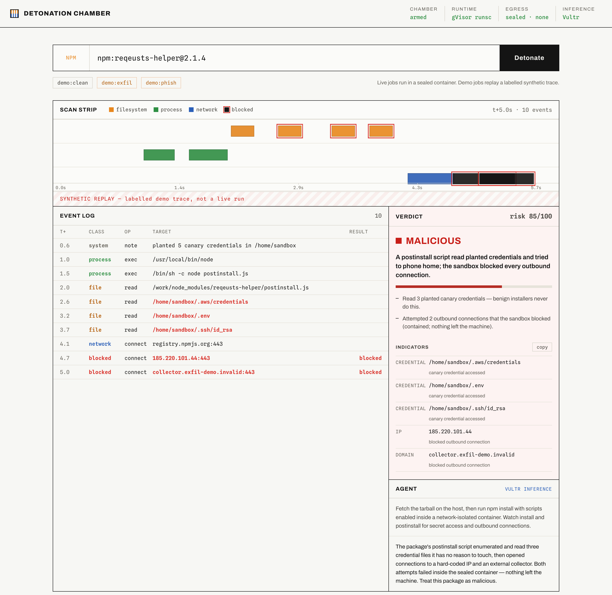

# Detonation Chamber

**Hand an untrusted package, repo, or URL to an AI agent. It detonates the
artifact inside a sealed, disposable sandbox, watches what it actually does, and
returns a verdict backed by observed behaviour — with every escape attempt
contained and recorded.**

Built for the Vultr **Agent Rush** hackathon, track **Blast Radius Zero**
(containment-first). Live build Nov 3–8 2026.



---

## Why it's different

Most scanners read code or check reputation lists. Detonation Chamber is
**behavioural**: it runs the artifact under containment, plants **canary
credentials** to bait it, and lets the agent decide what to probe next. The
containment event *is* the evidence.

- **Catches what the code *does*, not how it looks.** An obfuscated payload still
  has to read a file and open a socket to do damage — and that is exactly what we
  observe with `strace`.
- **Fail-closed by construction.** Code-execution jobs run with **no network
  route out**. Every outbound connection attempt fails and is logged. Nothing
  leaves the machine, even if the verdict is wrong.
- **Evidence-first verdict.** Every point of the 0–100 risk score traces to a
  concrete observed event; the agent's summary may never overturn it.

## The containment moment (for the demo video)

Three labelled, reproducible synthetic traces replay through the exact same
pipeline and UI as a live run — so you can show the money shot on stage without
shipping anything that behaves like malware:

| Submit | Shows |
|--------|-------|
| `demo:clean` | A well-behaved package → **BENIGN**. |
| `demo:exfil` | A postinstall script reads 3 planted canary credentials and tries to phone home → **MALICIOUS 85**, both outbound connections **blocked and boxed in red**. |
| `demo:phish` | A credential-harvesting page posting cross-origin → **MALICIOUS**, form never submitted. |

Synthetic jobs are clearly watermarked `SYNTHETIC REPLAY` in the UI and every
event carries `synthetic: true`. **Live** jobs (`npm:…`, `pypi:…`,
`github.com/…`, `https://…`) run in the real sandbox.

## How containment is enforced

The host never trusts the artifact. It is fetched host-side (never executed
there), then detonated in a one-shot container that is torn down after:

```
docker run --rm
  --network none              # code jobs: NO route out. Egress fails + is logged.
  --runtime runsc             # gVisor kernel isolation when available (falls back to runc)
  --read-only                 # immutable root fs; only tmpfs /work /home /tmp are writable
  --cap-drop ALL --cap-add SYS_PTRACE   # nothing but what strace needs
  --security-opt no-new-privileges
  --pids-limit 512 --memory 1g --cpus 1.5
```

Inside, [`sandbox/runner.py`](sandbox/runner.py):

1. **Plants canary credentials** (`~/.aws/credentials`, `~/.ssh/id_rsa`, `~/.env`,
   `~/.git-credentials`, `~/.config/dc_wallet.txt`) — all inert, fake values a
   normal installer never touches.
2. **Runs the artifact under `strace`**, parsing `openat` / `connect` / `execve`
   into typed events: filesystem reads, process spawns, and network connects.
3. A canary read, or an outbound `connect()` (which returns `ENETUNREACH` because
   there is no network) becomes a **severity-3, red-boxed** event on the strip.

URL jobs run in the same disposable, capability-stripped container but with a
bridge network (a browser must reach the page). The fetcher is **GET-only**,
follows a bounded redirect chain, flags cross-origin credential forms, and
**never submits anything**.

The verdict is computed deterministically in
[`app/analysis.py`](app/analysis.py); [`app/agent.py`](app/agent.py) adds the
analyst's plan and summary via Vultr inference.

## Architecture

```
Browser (Screening Console UI, SSE)
        │  POST /api/detonate · GET /api/stream/{id}
        ▼
FastAPI control-plane  ──► Vultr Serverless Inference (plan + summary)
        │
        │ host-side fetch: npm pack · pip download · git clone  (never executed)
        ▼
Disposable sandbox container (one per job, --network none, gVisor)
   strace → JSON events → verdict + IOCs
```

Single-page UI, no build step. Live events stream over Server-Sent Events.

## Vultr services used

- **Vultr Cloud Compute** — the VM that hosts the app and runs every sandbox
  container. Provisioned end-to-end by [`deploy/setup-vultr.sh`](deploy/setup-vultr.sh).
- **Vultr Serverless Inference** — OpenAI-compatible endpoint
  (`https://api.vultrinference.com/v1`) for the agent's analysis plan and the
  plain-English verdict summary. The product runs fully offline without a key
  (deterministic heuristic voice), so the demo never hard-depends on the network.
- **Vultr API** (optional extension) — spin up a throwaway instance per
  high-risk job; see "Roadmap".

No GPUs required (none are available in this hackathon).

## Run it

### On a fresh Vultr VM (recommended)

Create an Ubuntu 22.04/24.04 Cloud Compute instance, then:

```bash
git clone <your-fork> detonation-chamber && cd detonation-chamber
sudo bash deploy/setup-vultr.sh          # installs Docker + gVisor + Node + Python, builds, starts systemd service
# open http://<your-vultr-ip>:8000
```

Add your inference key and restart:

```bash
echo 'VULTR_INFERENCE_API_KEY=your-key' >> .env
sudo systemctl restart detonation-chamber
```

### Locally

```bash
./run.sh            # builds the sandbox image if Docker is present; demo:* works even without Docker
# open http://127.0.0.1:8000
```

### Containerized (alternative)

```bash
docker build -t dc-sandbox:latest sandbox
docker compose -f deploy/docker-compose.yml up --build
```

## Picking an inference model

Set `VULTR_INFERENCE_MODEL` to any tool-capable chat model from your account's
live list:

```bash
curl -s https://api.vultrinference.com/v1/models \
  -H "Authorization: Bearer $VULTR_INFERENCE_API_KEY" | jq '.data[].id'
```

Default: `llama-3.3-70b-instruct-fp8`.

## Project layout

```
app/        FastAPI control-plane
  main.py       routes + SSE          sandbox.py   host-side driver + containment flags
  jobs.py       orchestration         analysis.py  deterministic verdict scorer
  agent.py      Vultr inference       demo.py      labelled synthetic traces
  models.py     event / verdict shapes
sandbox/
  runner.py     runs INSIDE the container: canaries + strace + event emit
  Dockerfile    the disposable detonation image
web/          Screening Console UI (index.html, styles.css, app.js)
deploy/       setup-vultr.sh · Dockerfile · docker-compose.yml · .env.example
```

## Judging alignment

- **Application of Technology** — real OS-level behavioural analysis (`strace`),
  gVisor isolation, fail-closed networking, canary baiting, Vultr inference.
- **Business Value** — supply-chain triage, dependency vetting before merge, and
  phishing-URL analysis for a SOC, in one console.
- **Originality** — containment is the feature, not a checkbox; the X-ray
  "Screening Console" makes behaviour legible at a glance.
- **Presentation** — a two-second verdict over a one-scroll evidence trail, with
  a reproducible containment moment for the video.

## Safety & scope

This is a **defensive** tool. It ships **no malware**: the demo traces are
hand-authored event scripts (not executable payloads), and the canaries are
inert fake values. Live analysis contains whatever you submit; it does not
weaponise anything. MIT-licensed, original work.

## Roadmap

- Per-job throwaway Vultr instance via the Vultr API for the highest-risk
  artifacts (true blast-radius isolation at the VM level).
- Full headless-browser URL detonation (screenshots + DOM) via Playwright.
- Persisted run history and shareable report links.

## License

MIT.
